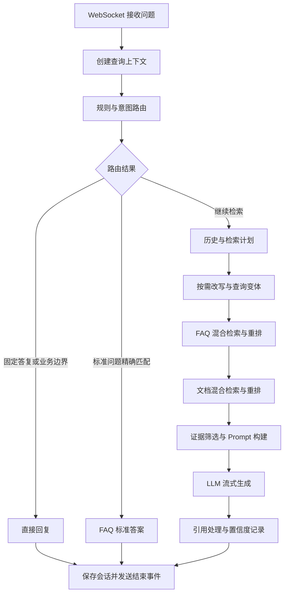

# 智能阀知识助手

基于 FastAPI、LangChain 和 Milvus 的 RAG 应用，为产品咨询、参数查询和初步选型提供带来源引用的回答。系统结合 FAQ 与产品文档检索，通过 WebSocket 输出流式回答，并提供会话、反馈与知识库版本管理。

仓库包含应用源码、前端、环境配置模板、Docker 编排以及模型准备、入库工具。产品资料、FAQ、意图训练数据、模型权重和真实凭据由使用者自行准备。

## 问答流程



FAQ 直答仅用于前置快路径中的标准问题精确匹配。进入完整检索链路后，FAQ 得分不会触发提前直答，仍继续文档检索与回答生成。

检索使用 BGE-M3 向量和 BM25，候选由 BGE Reranker 重排。FAQ 默认使用“标准问题＋标准答案”作为重排输入，文档使用原 chunk 正文；原 Document 与生成上下文保持不变。`FAQ_RERANK_INPUT_MODE` 可选 `question_answer`（默认）或 `question`，并参与检索缓存键。

## 代码阅读顺序

| 入口 | 职责 |
| --- | --- |
| [app.py](app.py) | 创建应用、注册路由、启动校验与模型预热 |
| [qa_core/api/chat.py](qa_core/api/chat.py) | 接收提问与发送 WebSocket 事件 |
| [qa_core/application/service.py](qa_core/application/service.py) | 问答服务入口 |
| [qa_core/pipeline/rag.py](qa_core/pipeline/rag.py) | 编排路由、检索、上下文与生成 |
| [qa_core/pipeline/steps.py](qa_core/pipeline/steps.py) | 路由判断、检索准备与回答准备 |
| [qa_core/pipeline/retrieval_steps.py](qa_core/pipeline/retrieval_steps.py) | FAQ 与文档检索步骤 |
| [qa_core/retrieval/store.py](qa_core/retrieval/store.py) | Milvus 混合检索与数据过滤 |
| [qa_core/retrieval/ranking.py](qa_core/retrieval/ranking.py) | 候选融合、去重与重排 |
| [qa_core/pipeline/context.py](qa_core/pipeline/context.py) | 组织回答证据 |
| [qa_core/llm/client.py](qa_core/llm/client.py) | 模型调用与连接状态 |
| [scripts/rebuild_kb_version.py](scripts/rebuild_kb_version.py) | FAQ、文档入库与版本发布 |

入库链路为：创建 STAGED 版本 → FAQ 入库 → 文档解析、规范化与切分 → 向量写入 → 入库质量检查 → 门禁通过后激活。增量构建复用未变化文档的 chunk；版本与有效期管理位于 `qa_core/governance/`。

## 目录

```text
app.py                         FastAPI 入口
qa_core/                       API、意图、RAG、入库、存储与治理代码
static/                        用户端与管理端前端
scripts/                       模型下载、意图训练、入库、版本管理与 OCR 工具
config/rules.toml              实际运行的路由与检索规则
data_packs/smart_valve_sales/
  scenario.toml                集合、资料路径与业务分类配置
.env.compose.example           Docker 环境模板
.env.local.example             本地 Python 环境模板
Dockerfile / Dockerfile.base   应用与基础运行镜像
docker-compose.yml             MySQL、Redis、Milvus 等服务编排
requirements.txt               Python 依赖
```

## 首次运行：Docker Compose

所有命令在项目根目录执行。需要 Docker 与 Compose、可用的 OpenAI 兼容模型服务，以及能够下载镜像、Python 依赖和模型的网络。运行镜像使用 Python 3.12；多个模型与数据库需要充足内存和磁盘，建议使用至少 16GB 内存的机器，并串行执行训练、入库与服务启动。

### 1. 填写配置并构建镜像

复制 [.env.compose.example](.env.compose.example) 为 `.env.compose`。Linux / macOS：

```bash
cp .env.compose.example .env.compose
```

Windows PowerShell：

```powershell
Copy-Item .env.compose.example .env.compose
```

填写真实 `DASHSCOPE_API_KEY` 和随机长 `ADMIN_API_TOKEN`，确认 `DASHSCOPE_BASE_URL` 与 `LLM_MODEL` 对应你的模型服务。变量名保留历史命名，接口使用 OpenAI 兼容协议。

容器内保持 `MYSQL_HOST=mysql`、`REDIS_HOST=redis`、`MILVUS_URI=http://milvus:19530`。`MYSQL_USER=root` 与 Compose 初始化一致；`MYSQL_PASSWORD` 同时用于数据库初始化与应用连接。已有数据库卷不会因为修改环境变量自动更新密码。

端口冲突时修改 `*_PUBLISHED_PORT` 与 `API_PORT`。模板中的数据库与 MinIO 默认凭据用于本地运行；部署时需自行设置访问策略。`LANGSMITH_TRACING=false` 时无需真实 LangSmith Key。

```bash
docker compose --env-file .env.compose config --quiet
docker build -f Dockerfile.base -t localhost/smart-valve-assistant-base:py312 .
docker compose --env-file .env.compose build api
```

应用镜像依赖本地基础镜像，首次构建不能省略第二条命令。

### 2. 准备自己的资料与训练数据

使用宿主机 Python 创建目录：

```bash
python -c "from pathlib import Path; [Path(p).mkdir(parents=True, exist_ok=True) for p in ['models', 'local_data/intent', 'data_packs/smart_valve_sales/product_data', 'data_packs/smart_valve_sales/faq', 'reports', 'logs']]"
```

将产品文档放入 `data_packs/smart_valve_sales/product_data/`。支持 PDF、Excel、Word、PowerPoint 等格式，具体解析器见 `qa_core/indexing/document_loaders.py`。初次使用建议采用可提取文字的文档；扫描件与图片资料需要经过 OCR 和复核流程。

将 FAQ 保存为 UTF-8 CSV：`data_packs/smart_valve_sales/faq/faq.csv`。必须包含 `question`、`answer`、`source` 三列，分别为标准问题、标准答案与来源分类。默认场景的 `source` 填写 `product`。问题、答案不可为空，标准问题应避免重复，并与文档内容一致。

准备自己的 `local_data/intent/train.jsonl` 与 `local_data/intent/eval.jsonl`。每行是 JSON 对象，字段为：

| 字段 | 类型与约束 |
| --- | --- |
| `query` | 非空问题字符串 |
| `label` | `FAQ_QUERY`、`KNOWLEDGE_QUERY` 或 `FOLLOW_UP` |
| `has_history` | JSON 布尔值，表示是否有历史对话 |

两份数据均需覆盖三个标签，不能包含重复的 `(query, has_history)`，训练集与评测集之间也不能重叠。使用与你的业务有关的代表性问题，训练质量取决于数据覆盖与标注。

资料与训练数据被 Git 和 Docker 构建上下文忽略，通过 Compose 卷挂载提供给容器。路径和分类由 [scenario.toml](data_packs/smart_valve_sales/scenario.toml) 定义；当前应用固定使用 `smart_valve_sales` 场景标识。

### 3. 下载基础模型并训练意图模型

```bash
docker compose --env-file .env.compose run --rm --no-deps api python scripts/tools/download_models.py
docker compose --env-file .env.compose run --rm --no-deps api python scripts/intent/train_intent_bert.py --base-model /app/models/bert-base-chinese --output /app/models/bert_intent_classifier_v1 --train-data local_data/intent/train.jsonl --eval-data local_data/intent/eval.jsonl
```

下载工具获取 `BAAI/bge-m3`、`BAAI/bge-reranker-large` 和 `google-bert/bert-base-chinese`。`bert_intent_classifier_v1` 是训练产物，不能用同名公共模型替代。

已有兼容模型时可跳过对应下载或训练。运行前需有三个完整目录：

```text
models/bge-m3/
models/bge-reranker-large/
models/bert_intent_classifier_v1/
```

意图模型需包含权重、tokenizer、`config.json` 与 `intent_labels.json`，标签顺序为 `FAQ_QUERY`、`KNOWLEDGE_QUERY`、`FOLLOW_UP`。训练脚本会保存这些文件；训练会写入输出目录，已有模型请先备份。

### 4. 启动依赖并构建知识库

```bash
docker compose --env-file .env.compose up -d mysql redis etcd minio milvus
docker compose --env-file .env.compose ps
```

等待依赖服务达到 healthy，Milvus 首次启动可能需要数分钟。然后入库：

```bash
docker compose --env-file .env.compose run --rm api python scripts/rebuild_kb_version.py --scenario smart_valve_sales --new-version --force --quality-gate --activate
```

门禁通过才激活新版本。失败时检查 `reports/ingestion/` 的报告，修正解析、分类、FAQ 重复或内容冲突后重试。门禁阈值定义在 `scripts/quality/check_ingestion_quality_gate.py`；首次启动保留默认门禁。

### 5. 启动并访问系统

```bash
docker compose --env-file .env.compose up -d api
docker compose --env-file .env.compose ps
```

默认地址如下；修改 `API_PORT` 后同步调整访问端口：

- 用户端：`http://127.0.0.1:8000/`
- 管理端：`http://127.0.0.1:8000/admin`
- API 文档：`http://127.0.0.1:8000/api/docs`
- 健康状态：`http://127.0.0.1:8000/health`

启动校验配置、资料路径、模型文件、数据库连接与激活版本，并等待检索预热完成。查看健康状态和日志后，用自己的 FAQ 与文档问题验证回答及引用。

前端提供销售、客服角色切换，资料默认同时授权两个岗位。该切换用于展示 ACL 机制，正式身份认证需接入可信登录系统。

## 本地 Python 运行

使用 Python 3.12，创建虚拟环境并安装 `requirements.txt`。复制 [.env.local.example](.env.local.example) 为 `.env`，填写真实凭据，并按上面的步骤准备资料、模型和激活知识库。

本地模板连接宿主机 MySQL `13307`、Milvus `19530` 和 Redis `6379`，对应默认 Compose 映射。若修改映射，本地配置也需更新。首次构建、训练与入库可继续使用 Docker 命令，然后运行：

```bash
python app.py
```

运行本地服务前停止 Compose 的 API 容器，或使用不同的 `API_PORT`。

## 日常操作

```bash
# 查看日志
docker compose --env-file .env.compose logs --tail 100 api milvus

# 更新资料后增量入库并激活
docker compose --env-file .env.compose run --rm api python scripts/rebuild_kb_version.py --scenario smart_valve_sales --new-version --incremental-from active --quality-gate --activate

# 查看知识库版本
docker compose --env-file .env.compose run --rm api python scripts/kb/manage_kb_versions.py list

# 停止服务，保留数据卷
docker compose --env-file .env.compose down
```

`down -v` 会删除数据卷，`--reset-collections` 会删除所选向量集合，两者都不属于正常首次启动步骤。

模型缺失时检查路径与标签文件；数据库连接失败时检查依赖健康状态与服务名；入库失败时查看质量报告；LLM 鉴权失败时检查 Key、接口地址和模型名称。完整配置项见 [qa_core/config/settings.py](qa_core/config/settings.py)。
